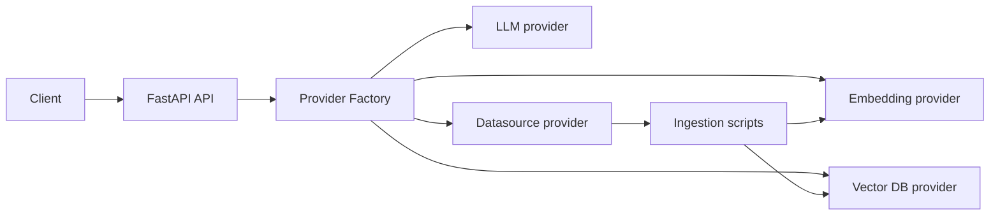

# rag-kit

Reusable, provider-swappable Retrieval-Augmented Generation (RAG) API built with FastAPI. The default stack uses Gemini for generation and embeddings, Qdrant for vector search, and MySQL or a local JSON file for ingestion.

## Architecture



Provider interfaces live under `app/providers/{llm,embedding,vectordb,datasource}`. The API retrieves context from the vector database, then streams an answer from the selected LLM. Datasources are used by ingestion; chat requests do not query MySQL.

## Quick start

Install the lightweight dependencies and create local configuration:

```bash
python -m venv .venv
# Windows: .venv\Scripts\activate
# Linux/macOS: source .venv/bin/activate
python -m pip install -e ".[dev]"
copy .env.example .env       # Windows
# cp .env.example .env       # Linux/macOS
```

Set the four required values in `.env`: `CHAT_INTERNAL_KEY`, `GEMINI_API_KEY`, `QDRANT_URL`, and `QDRANT_API_KEY`. The example defaults to `DATASOURCE=file`, so MySQL is not needed for the bundled sample dataset. Never commit `.env`.

### Cloud services

For an external Qdrant cluster, set `QDRANT_URL` to the cloud HTTPS endpoint and provide `QDRANT_API_KEY`. The sample dataset uses `DATASOURCE=file` and does not need MySQL:

```bash
# .env
QDRANT_URL=https://your-qdrant-cluster.example
QDRANT_API_KEY=replace-me
DATASOURCE=file

python scripts/ingest_sample.py
uvicorn app.main:app --host 0.0.0.0 --port 8000
```

Or run the API and optional tunnel with Docker:

```bash
docker compose --profile cloud up --build
```

The `cloud` profile expects `CLOUDFLARE_TOKEN` if the tunnel service is enabled. Gemini and the configured Qdrant/MySQL endpoints remain external services.

### Self-hosted Qdrant

For the local Qdrant container, use the service hostname inside Docker:

```bash
# .env
QDRANT_URL=http://qdrant:6333
QDRANT_API_KEY=
DATASOURCE=file

docker compose --profile selfhost up --build
docker compose exec fastapi python scripts/ingest_sample.py
```

The API is available at `http://localhost:8000`. If Python runs on the host while Qdrant runs locally, use `QDRANT_URL=http://localhost:6333` instead of the Docker hostname.

For a separately running local Qdrant instance, use `QDRANT_URL=http://localhost:6333` and run the API with Python directly.

### Qdrant URL

- Python running on the host: `http://localhost:6333`
- API running inside Docker Compose: `http://qdrant:6333`
- Qdrant Cloud: the HTTPS cluster URL and its API key

The bundled sample dataset is [data/sample.json](data/sample.json), and the no-MySQL ingestion command is:

```bash
DATASOURCE=file python scripts/ingest_sample.py
```

PowerShell:

```powershell
$env:DATASOURCE = "file"
python scripts/ingest_sample.py
```

## MySQL quick start

The generic MySQL synchronizer expects one table or view with a document ID and text column. Configure these variables in `.env`:

```dotenv
DATASOURCE=mysql
MYSQL_HOST=127.0.0.1
MYSQL_PORT=3307
MYSQL_USER=rag_kit
MYSQL_PASSWORD=rag_kit_pw
MYSQL_DATABASE=rag_kit
MYSQL_DOCUMENT_TABLE=documents
MYSQL_DOCUMENT_ID_COLUMN=id
MYSQL_DOCUMENT_TEXT_COLUMN=text
MYSQL_DOCUMENT_METADATA_COLUMNS=category,price
QDRANT_URL=http://localhost:6333
QDRANT_COLLECTION=rag_documents
```

Run the synchronizer manually:

```bash
python scripts/sync_mysql_to_qdrant.py
```

Use `--dry-run` with `--prune` first to preview deletion candidates. It reads the current MySQL rows and scoped Qdrant IDs, but does not embed, upsert, or delete:

```bash
python scripts/sync_mysql_to_qdrant.py --prune --dry-run
```

After reviewing the preview, run a scoped prune:

```bash
python scripts/sync_mysql_to_qdrant.py --prune
```

Prune only considers points written by this synchronizer for the configured MySQL table. It adds a `sync_source` payload marker to new or re-synced points; points ingested by v0.1.0 without that marker are intentionally not pruned until they are re-synced. The command aborts when MySQL returns no rows, or when more than 50% of scoped points would be deleted. Use `--allow-empty-prune` only when an empty source is intentional, and `--force` only after reviewing a large deletion. `--dry-run` without `--prune` is an error.

For a real local integration test, start the disposable MySQL and self-hosted Qdrant services, then run the opt-in harness:

MySQL integration test needs local Qdrant: `docker compose --profile selfhost up -d qdrant`

```bash
docker compose --profile mysql-test --profile selfhost up -d
python scripts/test_mysql_sync.py
```

The test uses MySQL host port `3307`, seeds `data/mysql_seed.sql`, syncs into `rag_kit_mysql_test`, checks payloads and the chat endpoint, verifies a second sync does not duplicate points, and drops the test collection. It is not part of the default `pytest` or CI run.

To schedule a sync hourly with cron:

```cron
0 * * * * cd /opt/rag-kit && /opt/rag-kit/.venv/bin/python scripts/sync_mysql_to_qdrant.py >> /var/log/rag-kit-sync.log 2>&1
```

## Using multiple tables

Create a view that normalizes multiple sources into one document shape, then point the synchronizer at the view:

```sql
CREATE VIEW rag_documents AS
SELECT id, title AS text, 'catalog' AS category, price
FROM catalog_items
UNION ALL
SELECT id + 1000000, description AS text, 'support' AS category, NULL AS price
FROM support_articles;
```

Configure `MYSQL_DOCUMENT_TABLE=rag_documents`, `MYSQL_DOCUMENT_ID_COLUMN=id`, `MYSQL_DOCUMENT_TEXT_COLUMN=text`, and `MYSQL_DOCUMENT_METADATA_COLUMNS=category,price`.

## Breaking changes in v0.2.0

- CORS now allows no cross-origin requests by default. Set `CORS_ALLOW_ORIGINS` to a comma-separated list of trusted frontend origins. The legacy `*` value remains supported, but logs a startup warning and disables credentialed CORS.

## Security notes

> **Warning**: `CORS_ALLOW_ORIGINS=*` is insecure for production. Use explicit trusted frontend origins instead.

- Keep `.env` out of Git and use a strong, rotated `CHAT_INTERNAL_KEY`.
- Put the API behind HTTPS, use a read-only MySQL account, and keep Qdrant private and authenticated.
- Keep `SECRET_SCAN_MODE=block`. The scanner is heuristic, not a guarantee. Never place passwords, tokens, or keys in source data.
- Authentication is one shared API key plus IP-based rate limiting; there are no users, roles, or tenant boundaries.

## Data safety

Ingestion scans document text and metadata before embedding or writing to Qdrant. Set `SECRET_SCAN_MODE` to:

- `block` (default): stop the batch and report only source ID, field, finding type, and count.
- `redact`: replace detected values with `[REDACTED:<type>]`, then continue and print a value-free summary.
- `off`: disable the guard; use only when the source is already controlled.

MySQL columns named by `SECRET_SCAN_BLOCKED_COLUMNS` are never selected or ingested. If block mode reports a finding, remove the sensitive value from the source, rotate the exposed credential when appropriate, and re-run ingestion. `scripts/audit_collection.py` scans an existing configured Qdrant collection without printing values:

```bash
python scripts/audit_collection.py
python scripts/audit_collection.py --delete  # requires typing DELETE after the report
```

Detection combines provider-key patterns, credential formats, and a high-entropy heuristic. It is not a guarantee: false positives and misses are possible, so credentials should never be placed in source data at all.

## Known limitations

> **Known limitations**: Review these before using rag-kit in production.

- v0.1.0 MySQL points without the `sync_source` payload marker are not eligible for pruning until they are re-synced.
- Wildcard CORS remains available for development compatibility, but it cannot be combined with credentialed CORS and should not be used in production.
- Changing `EMBEDDING_MODEL` or `EMBEDDING_DIM` requires a new collection and full re-ingestion.
- Synchronization is manual or externally scheduled; there is no automatic sync.
- Each table or view contributes one configured text column per row.
- Only Gemini and Qdrant providers exist today; MySQL and file are datasource providers.
- Chat requires Qdrant to be reachable; the API reports degraded health otherwise.
- There is no frontend or admin UI.
- `scripts/seed_sample_data.py` is legacy. Use `scripts/ingest_sample.py` or `scripts/sync_mysql_to_qdrant.py`.

## Production checklist

- Put the API behind an HTTPS reverse proxy.
- Restrict `CORS_ALLOW_ORIGINS` to trusted origins; do not use `*` in production.
- Use a strong, rotated `CHAT_INTERNAL_KEY`.
- Run the API and scheduled synchronizer as managed services with log rotation and restart policies.

## API

- `GET /health` returns `online` when Qdrant is ready and `degraded` when startup cannot reach it.
- `GET /api/v1/health` returns the same health payload through the versioned API.
- `POST /api/v1/chat/stream` streams Server-Sent Events and requires `X-Chat-API-Key`.
- Result cards are disabled by default. Set `ENABLE_CARDS=true` to emit generic metadata-based cards.

Example:

```bash
curl -N http://localhost:8000/api/v1/chat/stream \
  -H "Content-Type: application/json" \
  -H "X-Chat-API-Key: $CHAT_INTERNAL_KEY" \
  -d '{"message":"What information is available?"}'
```

## API versioning

The current API is served under `/api/v1`. Breaking changes will use `/api/v2`; no breaking changes are introduced within `/api/v1`.

## Environment variables

| Variable | Default | Purpose |
| --- | --- | --- |
| `APP_NAME` | `rag-kit` | Service name |
| `APP_VERSION` | `0.2.0` | API version |
| `APP_HOST` | `0.0.0.0` | Bind address for local runners |
| `APP_PORT` | `8000` | Local/API port |
| `API_V1_PREFIX` | `/api/v1` | Versioned API route prefix |
| `DEBUG` | `false` | Debug mode toggle |
| `CHAT_INTERNAL_KEY` | empty | Required chat authentication key |
| `ENABLE_CARDS` | `false` | Optional generic result-card output |
| `RETRIEVAL_TOP_K` | `6` | Number of vector results retrieved per request |
| `CARD_MAX_ITEMS` | `5` | Maximum result cards emitted |
| `CORS_ALLOW_ORIGINS` | empty | Comma-separated CORS origins |
| `LLM_PROVIDER` | `gemini` | LLM factory selection |
| `LLM_MODEL` | `gemini-2.5-flash` | LLM model name |
| `GEMINI_API_KEY` | empty | Gemini authentication |
| `EMBEDDING_PROVIDER` | `gemini` | Embedding factory selection |
| `EMBEDDING_MODEL` | `gemini-embedding-001` | Embedding model name |
| `EMBEDDING_DIM` | `768` | Vector dimension and Qdrant collection size |
| `RESPONSE_LANGUAGE` | `auto` | `auto` follows the user's language; otherwise uses this language label |
| `VECTOR_DB` | `qdrant` | Vector database factory selection |
| `QDRANT_URL` | `http://qdrant:6333` | Qdrant endpoint |
| `QDRANT_API_KEY` | empty | Optional Qdrant authentication |
| `QDRANT_COLLECTION` | `rag_documents` | Collection name |
| `QDRANT_TIMEOUT` | `120` | Qdrant client timeout in seconds |
| `DATASOURCE` | `mysql` | `mysql` or `file` datasource selection |
| `SAMPLE_DATA_PATH` | `data/sample.json` | JSON path for the file provider |
| `MYSQL_HOST` / `MYSQL_PORT` | `mysql` / `3306` | MySQL connection |
| `MYSQL_USER` / `MYSQL_PASSWORD` | `root` / empty | MySQL credentials |
| `MYSQL_DATABASE` | `rag_kit` | MySQL database |
| `MYSQL_CONNECT_TIMEOUT` | `5` | MySQL connection timeout in seconds |
| `MYSQL_DOCUMENT_TABLE` | `documents` | Generic source table for MySQL ingestion |
| `MYSQL_DOCUMENT_ID_COLUMN` | `id` | Source document ID column |
| `MYSQL_DOCUMENT_TEXT_COLUMN` | `text` | Source document text column |
| `MYSQL_DOCUMENT_METADATA_COLUMNS` | empty | Comma-separated optional metadata columns |
| `SECRET_SCAN_MODE` | `block` | Ingestion guard mode: `block`, `redact`, or `off` |
| `SECRET_SCAN_BLOCKED_COLUMNS` | `password,passwd,secret,token,api_key,private_key` | MySQL columns never ingested |
| `SECRET_SCAN_ALLOWLIST` | empty | Optional additional allowlist regexes, one per line |
| `PROMPT_TEMPLATE_PATH` | `prompts/system.txt` | Prompt file path |
| `PROMPT_TEMPLATE` | empty | Inline prompt override; `{context}` is replaced |
| `MEDIA_BASE_URL` | empty | Optional media base URL |
| `CARD_URL_TEMPLATE` | `/items/{slug}?id={id}` | Optional result-card URL template |
| `CLOUDFLARE_TOKEN` | empty | Optional tunnel token for the cloud profile |

## Adding a provider

1. Implement the relevant abstract interface in `app/providers/<kind>/base.py`.
2. Add the concrete implementation beside the existing providers.
3. Register its normalized name in `app/providers/factory.py`.
4. Add configuration variables and documentation to `.env.example` and this table.
5. Add unit tests that use fakes or local files rather than external credentials.

Keep ingestion and query embeddings on the same model and dimension. Changing `EMBEDDING_MODEL` or `EMBEDDING_DIM` requires re-embedding documents into a compatible collection.

## Troubleshooting

### Qdrant free cluster is paused

The service starts in degraded mode instead of crashing. Resume the cluster, verify `QDRANT_URL` and `QDRANT_API_KEY`, then restart the API. `/health` should report `"status": "online"`.

### Port already in use

Change `APP_PORT` in `.env`, or stop the process using port 8000. With Docker, the host-side port is controlled by `APP_PORT`; the container listens on 8000.

### Proxy/VPN connection reset

The smoke test deliberately bypasses system proxies. Run `python scripts/test_rag_pipeline.py` from a network that can reach the API, and check VPN/proxy rules if the API itself cannot reach Gemini or Qdrant.

### Embedding dimension changed

Qdrant rejects vectors whose size differs from the collection. Set the same `EMBEDDING_DIM` for ingestion and API, use a new collection, or rebuild the existing collection before ingesting again.

## Verification

```bash
python -m compileall -q app scripts tests
ruff check .
pytest -q
```

The live smoke test requires a running API and configured providers:

```bash
python scripts/test_rag_pipeline.py
```
