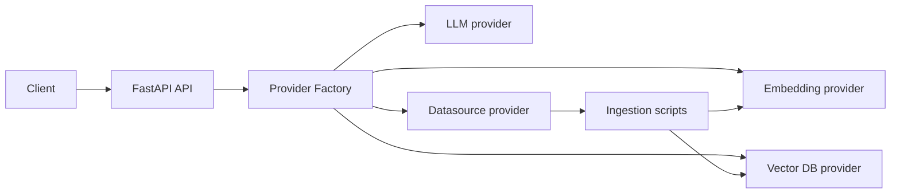

# rag-kit

Reusable, provider-swappable Retrieval-Augmented Generation (RAG) API built with FastAPI. The default stack uses Gemini for generation and embeddings, Qdrant for vector search, and MySQL or a local JSON file for ingestion.

## Architecture



Provider interfaces live under `app/providers/{llm,embedding,vectordb,datasource}`. The API retrieves context from the vector database, then streams an answer from the selected LLM. Datasources are used by ingestion; chat requests do not query MySQL.

## Quick start

Install the lightweight dependencies and create local configuration:

```bash
python -m venv .venv
# Windows: .venv\Scripts\activate
# Linux/macOS: source .venv/bin/activate
python -m pip install -e ".[dev]"
copy .env.example .env       # Windows
# cp .env.example .env       # Linux/macOS
```

Set the four required values in `.env`: `CHAT_INTERNAL_KEY`, `GEMINI_API_KEY`, `QDRANT_URL`, and `QDRANT_API_KEY`. The example defaults to `DATASOURCE=file`, so MySQL is not needed for the bundled sample dataset. Never commit `.env`.

### Cloud services

For an external Qdrant cluster, set `QDRANT_URL` to the cloud HTTPS endpoint and provide `QDRANT_API_KEY`. The sample dataset uses `DATASOURCE=file` and does not need MySQL:

```bash
# .env
QDRANT_URL=https://your-qdrant-cluster.example
QDRANT_API_KEY=replace-me
DATASOURCE=file

python scripts/ingest_sample.py
uvicorn app.main:app --host 0.0.0.0 --port 8000
```

Or run the API and optional tunnel with Docker:

```bash
docker compose --profile cloud up --build
```

The `cloud` profile expects `CLOUDFLARE_TOKEN` if the tunnel service is enabled. Gemini and the configured Qdrant/MySQL endpoints remain external services.

### Self-hosted Qdrant

For the local Qdrant container, use the service hostname inside Docker:

```bash
# .env
QDRANT_URL=http://qdrant:6333
QDRANT_API_KEY=
DATASOURCE=file

docker compose --profile selfhost up --build
docker compose exec fastapi python scripts/ingest_sample.py
```

The API is available at `http://localhost:8000`. If Python runs on the host while Qdrant runs locally, use `QDRANT_URL=http://localhost:6333` instead of the Docker hostname.

For a separately running local Qdrant instance, use `QDRANT_URL=http://localhost:6333` and run the API with Python directly.

The bundled sample dataset is [data/sample.json](data/sample.json), and the no-MySQL ingestion command is:

```bash
DATASOURCE=file python scripts/ingest_sample.py
```

PowerShell:

```powershell
$env:DATASOURCE = "file"
python scripts/ingest_sample.py
```

## API

- `GET /health` returns `online` when Qdrant is ready and `degraded` when startup cannot reach it.
- `POST /api/chat/stream` streams Server-Sent Events and requires `X-Chat-API-Key`.
- Result cards are disabled by default. Set `ENABLE_CARDS=true` to emit generic metadata-based cards.

Example:

```bash
curl -N http://localhost:8000/api/chat/stream \
  -H "Content-Type: application/json" \
  -H "X-Chat-API-Key: $CHAT_INTERNAL_KEY" \
  -d '{"message":"What information is available?"}'
```

## Environment variables

| Variable | Default | Purpose |
| --- | --- | --- |
| `APP_NAME` | `rag-kit` | Service name |
| `APP_VERSION` | `1.0.0` | API version |
| `APP_HOST` | `0.0.0.0` | Bind address for local runners |
| `APP_PORT` | `8000` | Local/API port |
| `DEBUG` | `false` | Debug mode toggle |
| `CHAT_INTERNAL_KEY` | empty | Required chat authentication key |
| `ENABLE_CARDS` | `false` | Optional generic result-card output |
| `RETRIEVAL_TOP_K` | `6` | Number of vector results retrieved per request |
| `CARD_MAX_ITEMS` | `5` | Maximum result cards emitted |
| `CORS_ALLOW_ORIGINS` | `*` | Comma-separated CORS origins |
| `LLM_PROVIDER` | `gemini` | LLM factory selection |
| `LLM_MODEL` | `gemini-2.5-flash` | LLM model name |
| `GEMINI_API_KEY` | empty | Gemini authentication |
| `EMBEDDING_PROVIDER` | `gemini` | Embedding factory selection |
| `EMBEDDING_MODEL` | `gemini-embedding-001` | Embedding model name |
| `EMBEDDING_DIM` | `768` | Vector dimension and Qdrant collection size |
| `RESPONSE_LANGUAGE` | `auto` | `auto` follows the user's language; otherwise uses this language label |
| `VECTOR_DB` | `qdrant` | Vector database factory selection |
| `QDRANT_URL` | `http://qdrant:6333` | Qdrant endpoint |
| `QDRANT_API_KEY` | empty | Optional Qdrant authentication |
| `QDRANT_COLLECTION` | `rag_documents` | Collection name |
| `QDRANT_TIMEOUT` | `120` | Qdrant client timeout in seconds |
| `DATASOURCE` | `mysql` | `mysql` or `file` datasource selection |
| `SAMPLE_DATA_PATH` | `data/sample.json` | JSON path for the file provider |
| `MYSQL_HOST` / `MYSQL_PORT` | `mysql` / `3306` | MySQL connection |
| `MYSQL_USER` / `MYSQL_PASSWORD` | `root` / empty | MySQL credentials |
| `MYSQL_DATABASE` | `rag_kit` | MySQL database |
| `MYSQL_CONNECT_TIMEOUT` | `5` | MySQL connection timeout in seconds |
| `MYSQL_DOCUMENT_TABLE` | `documents` | Generic source table for MySQL ingestion |
| `MYSQL_DOCUMENT_ID_COLUMN` | `id` | Source document ID column |
| `MYSQL_DOCUMENT_TEXT_COLUMN` | `text` | Source document text column |
| `MYSQL_DOCUMENT_METADATA_COLUMNS` | empty | Comma-separated optional metadata columns |
| `PROMPT_TEMPLATE_PATH` | `prompts/system.txt` | Prompt file path |
| `PROMPT_TEMPLATE` | empty | Inline prompt override; `{context}` is replaced |
| `MEDIA_BASE_URL` | empty | Optional media base URL |
| `CARD_URL_TEMPLATE` | `/items/{slug}?id={id}` | Optional result-card URL template |
| `CLOUDFLARE_TOKEN` | empty | Optional tunnel token for the cloud profile |

## Adding a provider

1. Implement the relevant abstract interface in `app/providers/<kind>/base.py`.
2. Add the concrete implementation beside the existing providers.
3. Register its normalized name in `app/providers/factory.py`.
4. Add configuration variables and documentation to `.env.example` and this table.
5. Add unit tests that use fakes or local files rather than external credentials.

Keep ingestion and query embeddings on the same model and dimension. Changing `EMBEDDING_MODEL` or `EMBEDDING_DIM` requires re-embedding documents into a compatible collection.

## Troubleshooting

### Qdrant free cluster is paused

The service starts in degraded mode instead of crashing. Resume the cluster, verify `QDRANT_URL` and `QDRANT_API_KEY`, then restart the API. `/health` should report `"status": "online"`.

### Port already in use

Change `APP_PORT` in `.env`, or stop the process using port 8000. With Docker, the host-side port is controlled by `APP_PORT`; the container listens on 8000.

### Proxy/VPN connection reset

The smoke test deliberately bypasses system proxies. Run `python scripts/test_rag_pipeline.py` from a network that can reach the API, and check VPN/proxy rules if the API itself cannot reach Gemini or Qdrant.

### Embedding dimension changed

Qdrant rejects vectors whose size differs from the collection. Set the same `EMBEDDING_DIM` for ingestion and API, use a new collection, or rebuild the existing collection before ingesting again.

## Verification

```bash
python -m compileall -q app scripts tests
ruff check .
pytest -q
```

The live smoke test requires a running API and configured providers:

```bash
python scripts/test_rag_pipeline.py
```
